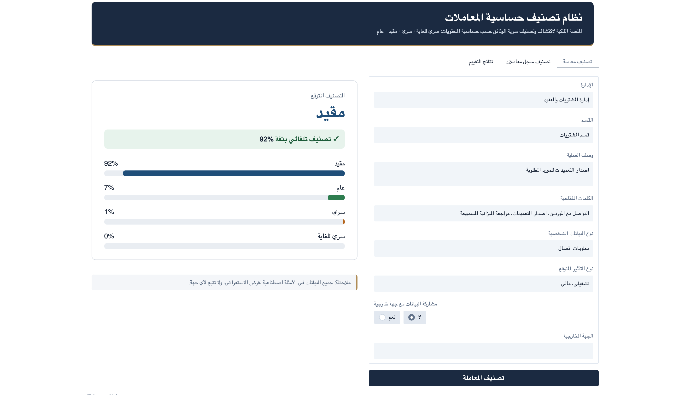
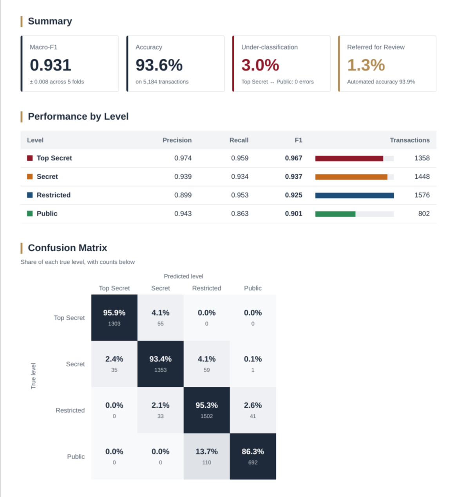
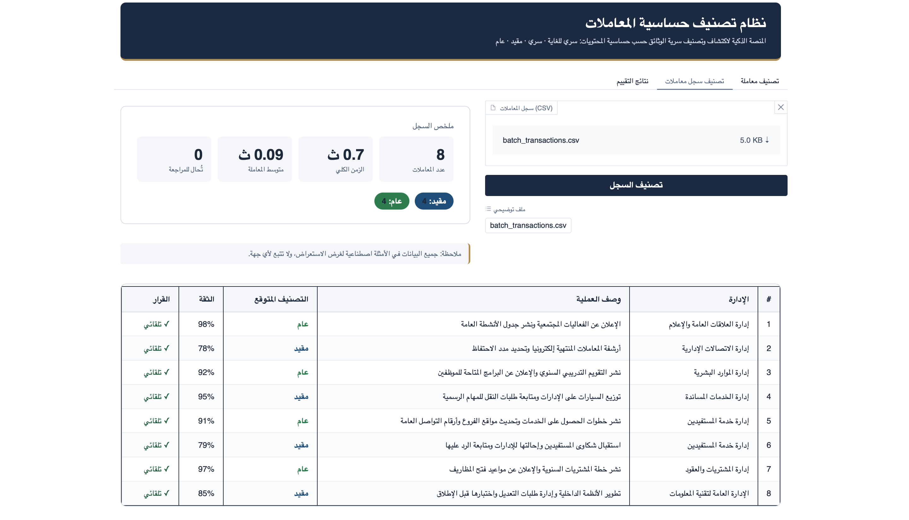

# Arabic Transaction Sensitivity Classification

تصنيف حساسية المعاملات الإدارية العربية إلى أربعة مستويات: سري للغاية، سري، مقيد، عام.

This project fine-tunes AraBERT with LoRA to classify Arabic transaction records into four sensitivity levels: Top Secret, Secret, Restricted and Public. Every prediction comes with a calibrated confidence score. Transactions below a confidence threshold are sent to human review instead of being classified automatically.

## The challenge

Each sensitivity level has a known vocabulary: the terms that usually signal it. Matching those terms works when a transaction uses them. The harder case is a new transaction written with words that never appeared in any labeled example, such as a new kind of security incident. A keyword or TF-IDF model has nothing to go on for a word it has never seen.

AraBERT was pre-trained on a large Arabic corpus, so it already places words with related meanings close to each other. Fine-tuning it here aims to carry that knowledge over: a transaction with an unfamiliar term that is close in meaning to known high-sensitivity terms should move toward the right level, and when the model is unsure, the transaction goes to human review instead of being classified automatically.

The evaluation below covers transactions that share vocabulary with the training data. Performance on terms never seen in training is not measured yet.



## Results

Results are reported on a synthetic dataset built for this project. No real transactions are included in this repository.

The dataset has 5,184 transactions: 1,358 Top Secret, 1,448 Secret, 1,576 Restricted and 802 Public. Labels depend mainly on the keywords in each record, and a small share of cases are ambiguous on purpose.

Evaluation is 5-fold cross-validation. Every transaction is tested once, by models that never saw it. Near-duplicate transactions are kept in the same fold so they cannot leak between training and test.

| Metric | Final model |
|---|---|
| Macro-F1 | 0.886 ± 0.043 (across 5 folds) |
| Accuracy | 91.1% |
| Under-classification (predicted less sensitive than the true level) | 5.1% |
| Top Secret / Public confusions | 0 |
| Calibration error (ECE) | 0.044 |
| Referred for review at the 60% threshold | 6.2% |
| Accuracy on the transactions classified automatically | 93.6% |

| Level | Precision | Recall | F1 | Transactions |
|---|---|---|---|---|
| Top Secret | 0.968 | 0.948 | 0.958 | 1,358 |
| Secret | 0.931 | 0.930 | 0.930 | 1,448 |
| Restricted | 0.888 | 0.896 | 0.892 | 1,576 |
| Public | 0.831 | 0.848 | 0.840 | 802 |

More than half of the errors are between Restricted and Public. Top Secret is never predicted as Public, and Public is never predicted as Top Secret.



### Model comparison

| Model | Macro-F1 |
|---|---|
| TF-IDF + logistic regression, class weights | 0.887 |
| TF-IDF + logistic regression, oversampling | 0.885 |
| TF-IDF + logistic regression, no balancing | 0.885 |
| TF-IDF + logistic regression, class weights + department | 0.848 |
| AraBERT + LoRA, class-weighted loss | 0.840 |
| AraBERT + LoRA, focal loss (three seeds) | 0.847, 0.844, 0.879 |
| Final model: AraBERT (focal loss, three seeds) + TF-IDF | 0.886 |

Each score is the mean over 5 folds. AraBERT alone lands in the same range as the TF-IDF baselines, and the final model is level with the best baseline. Differences of a few thousandths are within the fold-to-fold spread. Since labels here follow keywords closely, a lexical model is a strong baseline, so this comparison says little about free-text records.

## How it works

Each record is turned into one text string. Every non-empty form field is added as `field name: value`, and the fields are joined with `[SEP]`.

- **Encoder:** `aubmindlab/bert-base-arabertv02` with LoRA (rank 8) on the query and value projections. The `[CLS]` state and the mean-pooled state are concatenated and passed to a linear head. A department embedding can be switched on with `model.use_department`.
- **Loss:** focal loss (gamma 2) with balanced class weights, because the four levels are not evenly represented.
- **Calibration:** a temperature is fitted on the validation split of each fold, so the confidence score tracks real accuracy.
- **Final prediction:** the mean probability of the AraBERT checkpoints (3 seeds x 5 folds) and the mean probability of the TF-IDF models, weighted equally.
- **Human review:** a transaction with confidence below 0.6 is flagged `needs_review` instead of being classified automatically.

Each fold has its own validation split, used to pick the best checkpoint and to fit the temperature. The test fold is never used for either.

## Quick start

Tested with Python 3.13.

```bash
pip install -r requirements.txt
python -m src.predict examples/new_transactions.csv
python -m src.app
```

The first run downloads the AraBERT base model from Hugging Face. The checkpoints in `results/` only contain the LoRA weights and the classification head. Inference runs on CPU, CUDA or Apple MPS.

`src.predict` adds `predicted_level`, `confidence` and `needs_review` to the input file and writes it to `predictions_new.csv` (change it with `--output`). A sample output is in `examples/`.

The app classifies one transaction at a time, or a whole CSV file in the same column layout as `examples/new_transactions.csv`. For a file, it shows each row's level, confidence and decision, with a summary of the counts per level and how many rows are referred for review. Try it with `examples/batch_transactions.csv`.



## Training

The data is not published, so training needs your own CSV at the path set in `config.yaml` (`data.path`). Columns are found by the beginning of their header, in the same layout as `examples/new_transactions.csv`:

الإدارة, القسم, وصف العملية, النماذج المرتبطة, هل تحتوي البيانات, نوع البيانات الشخصية, المعالجة و الاستخدام, نوع التأثير, توضيح الكلمات, هل يتم مشاركة, من المخول, هل يتم رفع, اسم الجهة الخارجية

plus a label column starting with `رأي اللجنة`, holding one of: سري للغاية, سري, مقيد, عام.

Exact duplicates and rows with no label or no description and keywords are dropped. Rows with a missing department are kept.

```bash
python -m src.train --name tfidf_none --set model.imbalance=none
python -m src.train --name tfidf_weighted
python -m src.train --name tfidf_oversample --set model.imbalance=oversample
python -m src.train --name tfidf_weighted_dept --set model.use_department=true

python -m src.train --name arabert_focal --set model.type=arabert --set model.imbalance=focal
python -m src.train --name arabert_focal_seed1 --set model.type=arabert --set model.imbalance=focal --set seed=1
python -m src.train --name arabert_focal_seed2 --set model.type=arabert --set model.imbalance=focal --set seed=2
```

Settings are in `config.yaml`, and any of them can be overridden with `--set key=value`. The AraBERT runs were trained on a single T4 GPU. Each run writes its models, metrics and out-of-fold predictions to `results/<name>/` and adds a row to `results/summary.csv`.

## Repository layout

```
src/
  data.py       loading, cleaning, near-duplicate grouping, cross-validation folds
  models.py     TF-IDF classifier, AraBERT + LoRA classifier, calibration
  train.py      cross-validated training and evaluation
  predict.py    command-line prediction
  app.py        web interface
config.yaml     training settings
examples/       sample input and output
results/        metrics, out-of-fold predictions and trained models
assets/         screenshot
```

## Notes

- The dataset is synthetic and its labels follow keywords closely. Scores on real records would differ.
- The evaluation keeps every department in both training and test folds. Performance on departments the model has never seen is not reported here.

## License

MIT.
